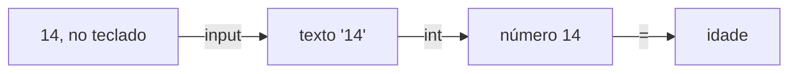

# Dados e interação

Neste guia, os teus programas passam a guardar valores com um nome, a fazer contas e a ler o que a pessoa escreve no teclado. É o que fizeste no guia 02 da algoritmia, agora em Python. Ainda não há decisões nem repetições: cada linha executa-se uma vez, de cima para baixo.

Usa o pseudocódigo da algoritmia e o `print` do tema 01. Rever: [Atribuição](../01-algoritmos/02-estado-sequencia-representacoes.md#atribuição-dar-um-valor-não-é-perguntar-se-é-igual), [Operadores aritméticos](../01-algoritmos/02-estado-sequencia-representacoes.md#operadores-aritméticos), [Chamar uma função](../01-algoritmos/05-funcoes-e-modelo-integrado.md#chamar-uma-função) e [Escrever no ecrã com `print`](01-do-pseudocodigo-ao-python.md#escrever-no-ecrã-com-print). Para praticar: [laboratório](laboratorios/02-dados-e-interacao-laboratorio.md) e [ficha de exercícios](exercicios/02-dados-e-interacao-exercicios.md).

## Neste guia

1. [Parte 1: Guardar valores](#parte-1-guardar-valores)
2. [Parte 2: Cada valor tem um tipo](#parte-2-cada-valor-tem-um-tipo)
3. [Parte 3: As contas](#parte-3-as-contas)
4. [Parte 4: As funções predefinidas](#parte-4-as-funções-predefinidas)
5. [Parte 5: Ler do teclado](#parte-5-ler-do-teclado)
6. [Exemplo guiado: minutos em horas e minutos](#exemplo-guiado-minutos-em-horas-e-minutos)

## Parte 1: Guardar valores

### Uma variável guarda um valor com um nome

No tema 01, um programa que escrevesse "Passaram 2 horas" tinha o 2 escrito no próprio `print`. Para mostrar outro número, era preciso mudar essa linha. Falta um sítio onde guardar o valor, com um nome, para o usar onde for preciso.

Esse sítio é a variável que conheces da algoritmia. Em Python, escreve-se sem o tipo à frente: o `int horas = 2` do pseudocódigo passa a ser só o nome, o `=` e o valor.

```python
horas = 2
```

O `=` é a atribuição, como no pseudocódigo: guarda o valor da direita na variável da esquerda. Lê-se "horas recebe 2". A variável nasce nesta linha, a primeira que lhe dá um valor.

Para usar o valor, escreve-se o nome, sem aspas. Com aspas, é um texto, e aparece a palavra.

```python
# horas.py: o mesmo nome, com aspas e sem aspas.
horas = 2
print("horas")
print(horas)
print("Passaram", horas, "horas")
```

```text
horas
2
Passaram 2 horas
```

O primeiro `print` recebe um texto e escreve a palavra. O segundo recebe o nome da variável e escreve o valor dela. O terceiro recebe três valores, dois textos e a variável, e o `print` põe um espaço entre eles. Por isso, os espaços que no pseudocódigo escrevias dentro das aspas aqui não se escrevem.

Uma variável não se pode usar antes da linha onde nasce. O Python lê o programa de cima para baixo e, nessa linha, ainda não conhece o nome.

```python
# antes.py: usa uma variável antes da linha onde ela nasce.
print("Pontos:", pontos)
pontos = 10
```

```text
Traceback (most recent call last):
  File "C:\Users\aluno\Documents\fp-python\antes.py", line 2, in <module>
    print("Pontos:", pontos)
                     ^^^^^^
NameError: name 'pontos' is not defined
```

A última linha quer dizer "erro de nome: o nome 'pontos' não está definido". É um erro de execução: o programa começou a correr e parou na linha 2. Corrige-se trocando as duas linhas, para a variável nascer antes de ser usada.

### Atribuir outra vez apaga o valor antigo

Num jogo, as moedas de um jogador mudam a toda a hora: apanha um baú e ganha, compra um escudo e gasta. O programa tem de mudar o valor da mesma variável muitas vezes.

Muda-se com outra atribuição, com o mesmo nome à esquerda. Como no pseudocódigo, faz-se em duas fases. Primeiro calcula-se o lado direito, com os valores que as variáveis têm nesse momento. Depois guarda-se o resultado na variável, e o valor antigo perde-se.

```python
# moedas.py: as moedas de um jogador ao longo de um nível.
moedas = 40
print("No início:", moedas)
moedas = moedas + 25
print("Depois do baú:", moedas)
moedas = moedas - 30
print("Depois de comprar um escudo:", moedas)
```

```text
No início: 40
Depois do baú: 65
Depois de comprar um escudo: 35
```

A tabela de trace mostra porquê. Cada linha é uma instrução executada, com o valor de `moedas` depois dela e o que aparece no ecrã. A coluna "Linha" é o número que o VS Code mostra à esquerda. O comentário da linha 1 não se executa.

| Passo | Linha | Instrução executada | `moedas` | Ecrã |
| ---: | ---: | --- | ---: | --- |
| 0 | | antes de começar | sem valor | nada |
| 1 | 2 | `moedas = 40` | 40 | nada |
| 2 | 3 | `print("No início:", moedas)` | 40 | No início: 40 |
| 3 | 4 | `moedas = moedas + 25` | 65 | nada |
| 4 | 5 | `print("Depois do baú:", moedas)` | 65 | Depois do baú: 65 |
| 5 | 6 | `moedas = moedas - 30` | 35 | nada |
| 6 | 7 | `print("Depois de comprar um escudo:", moedas)` | 35 | Depois de comprar um escudo: 35 |

No passo 3, o lado direito usa o 40 que `moedas` tem nesse momento, e dá 65. Só depois o 65 fica guardado, e o 40 perde-se. Um `print` nunca muda uma variável: só escreve o valor que ela tem.

<details>
<summary>Para ires mais longe: trocar os valores de duas variáveis</summary>

Este programa tenta trocar os valores de `a` e de `b`:

```python
# troca.py: uma tentativa de trocar os valores de duas variáveis.
a = 4
b = 9
a = b
b = a
print(a, b)
```

Escreve `9 9`, e não `9 4`. Na linha 4, `a` recebe o 9 de `b`, e o 4 perde-se. Na linha 5, `b` recebe o valor que `a` tem nesse momento, que já é 9. Para trocar mesmo, guarda-se primeiro, numa terceira variável, o valor que se ia perder:

```python
# troca_certa.py: troca os valores de duas variáveis com uma variável auxiliar.
a = 4
b = 9
auxiliar = a
a = b
b = auxiliar
print(a, b)
```

Agora escreve `9 4`, porque o 4 ficou guardado em `auxiliar` antes de `a` mudar.

</details>

### Os nomes seguem regras e uma convenção

Um nome bom diz o que a variável guarda: `moedas` diz mais do que `m` ou `x`.

O Python recusa os nomes que não cumprem estas regras:

- um nome tem letras, algarismos e o traço baixo, `_`;
- não começa por um algarismo: `2equipas` é recusado, e `equipas_2` é aceite;
- não tem espaços nem hífenes: `total pontos` e `total-pontos` são recusados.

As maiúsculas contam: `moedas` e `Moedas` são duas variáveis diferentes.

Além das regras, todo o código Python segue uma forma de escrever os nomes: tudo em minúsculas, com um traço baixo entre as palavras. É uma **convenção**, uma forma combinada entre as pessoas, que a linguagem não obriga a cumprir. Em pseudocódigo escrevias `totalPontos`, e em Python escreves `total_pontos`.

| Pseudocódigo | Python |
| --- | --- |
| `int totalPontos = 0` | `total_pontos = 0` |
| `float alturaMedia = 1.65` | `altura_media = 1.65` |
| `string nomeJogador = "Rita"` | `nome_jogador = "Rita"` |

Os nomes escrevem-se sem acentos nem cedilhas, como `preco` e `vitorias`, para ficarem iguais em qualquer teclado. Os acentos ficam dentro das aspas, como em `print("Vitórias:", vitorias)`.

Algumas palavras não podem ser nomes, porque já pertencem à linguagem. São as palavras reservadas, como `True` e `False`, o `true` e o `false` do pseudocódigo. O VS Code pinta-as de outra cor.

Um nome com um espaço nem chega a correr.

```python
# nome_com_espaco.py: um nome de variável com um espaço no meio.
total pontos = 0
```

```text
  File "C:\Users\aluno\Documents\fp-python\nome_com_espaco.py", line 2
    total pontos = 0
          ^^^^^^
SyntaxError: invalid syntax
```

Quer dizer "erro de sintaxe: escrita inválida". O Python leu `total` como um nome e não percebeu o que fazia ali `pontos`. Corrige-se com o traço baixo: `total_pontos`.

### As constantes têm o nome em maiúsculas

Num jogo, cada estrela vale 50 pontos. Esse 50 é uma regra do jogo, e não muda enquanto o programa corre. Solto no meio de uma conta, quem lê não sabe de onde vem. E se a regra mudar, tens de o procurar em todos os sítios onde aparece.

Na algoritmia, um valor destes era uma constante, com `const`. O Python não tem `const`: uma constante é uma variável com o nome todo em maiúsculas, que se combina não mudar. O `const PONTOS_POR_ESTRELA = 50` passa a `PONTOS_POR_ESTRELA = 50`. O Python não impede a mudança, mas o nome avisa quem lê. As constantes escrevem-se no início do programa, para se encontrarem depressa.

```python
# estrelas.py: os pontos que um jogador ganha pelas estrelas de um nível.
PONTOS_POR_ESTRELA = 50

estrelas = 7
pontos = estrelas * PONTOS_POR_ESTRELA
print("Pontos:", pontos)
```

O resultado é `Pontos: 350`, porque 7 vezes 50 dá 350. A linha 5 lê-se como uma frase: os pontos são as estrelas vezes os pontos de cada estrela. Se o jogo passar a dar 60 pontos por estrela, muda-se só a linha 2.

## Parte 2: Cada valor tem um tipo

O `7` e o `"7"` parecem a mesma coisa, mas com o primeiro fazem-se contas e com o segundo não. O que se pode fazer com um valor depende do tipo dele.

Na algoritmia, o tipo escrevia-se à frente da variável. Em Python, não se escreve: quando escreves `moedas = 40`, o Python vê que 40 é um inteiro. A isto chama-se **tipagem dinâmica**: o tipo está no valor, e não na variável, e o Python vê-o enquanto o programa corre.

| Tipo | O que guarda | Exemplos |
| --- | --- | --- |
| `int` | um número inteiro | `7`, `0`, `-3` |
| `float` | um número com parte decimal, escrita com ponto | `7.0`, `2.5`, `-0.1` |
| `str` | um texto, entre aspas; é o `string` do pseudocódigo | `"7"`, `"Olá"` |
| `bool` | só verdadeiro ou falso, com maiúscula | `True`, `False` |

Para saber o tipo de um valor, usa-se a função `type`, com o valor entre parênteses, aqui na consola do Python.

```text
>>> type(7)
<class 'int'>
>>> type(7.0)
<class 'float'>
>>> type("7")
<class 'str'>
>>> type(True)
<class 'bool'>
```

O Python responde com `<class '...'>`, e o nome entre as aspas é o tipo.

Escritos em minúsculas, como no pseudocódigo, os valores lógicos dão erro.

```text
>>> encontrado = true
Traceback (most recent call last):
  File "<python-input-0>", line 1, in <module>
    encontrado = true
                 ^^^^
NameError: name 'true' is not defined. Did you mean: 'True'?
```

Para o Python, `true` em minúsculas é o nome de uma variável que nunca nasceu. A mensagem sugere logo a correção: `True`, com maiúscula.

<details>
<summary>Para ires mais longe: uma variável pode mudar de tipo</summary>

Como o tipo está no valor, e não na variável, a mesma variável pode receber um valor de outro tipo:

```text
>>> x = 7
>>> type(x)
<class 'int'>
>>> x = "sete"
>>> type(x)
<class 'str'>
```

O Python deixa, mas nas aulas evita-se: uma variável guarda sempre o mesmo género de coisa, para o nome dizer sempre o mesmo.

</details>

## Parte 3: As contas

As contas escrevem-se quase como no pseudocódigo. Mudam a divisão inteira e o resto, que passam de palavras a sinais, e há um sinal novo, para a potência.

| Pseudocódigo | Python | O que faz | Exemplo | Resultado |
| --- | --- | --- | --- | ---: |
| `+` | `+` | soma | `7 + 2` | `9` |
| `-` | `-` | subtração | `7 - 2` | `5` |
| `*` | `*` | multiplicação | `7 * 2` | `14` |
| `/` | `/` | divisão, com parte decimal | `7 / 2` | `3.5` |
| `div` | `//` | divisão inteira: quantas vezes cabe | `7 // 2` | `3` |
| `resto` | `%` | o que sobra da divisão inteira | `7 % 2` | `1` |
| não havia | `**` | potência | `7 ** 2` | `49` |

### A divisão com `/` dá sempre um `float`

Na algoritmia, 21 a dividir por 3 dava 7. No Python também, mas escrito de outra maneira. Antes de leres as respostas, prevê o que a consola mostra na primeira linha.

```text
>>> 21 / 3
7.0
>>> 7 / 2
3.5
>>> 10 - 4
6
>>> 2 * 1.5
3.0
```

A primeira linha dá `7.0`, e não `7`, porque a divisão com `/` dá sempre um `float`, mesmo quando a conta é exata. O número é o mesmo, com outro tipo. As outras contas entre dois `int` dão um `int`, como `10 - 4`. Basta um `float` na conta para o resultado ser `float`, como em `2 * 1.5`.

<details>
<summary>Para ires mais longe: a divisão no Python 2</summary>

No Python 2, a versão antiga da linguagem, `7 / 2` dava `3`, porque uma divisão entre dois inteiros deitava fora a parte decimal. No Python 3, o mesmo código dá `3.5`, sem aviso nenhum. Quando encontrares um `/` em código antigo, pergunta-te se o autor queria a divisão com parte decimal ou a divisão inteira.

</details>

### A divisão inteira e o resto

Tens 17 rebuçados para dar a 5 amigos, sem partir nenhum. Cada um recebe 3, e sobram 2. Na algoritmia, eram as contas `17 div 5` e `17 resto 5`. No Python, o `div` escreve-se `//` e o `resto` escreve-se `%`.

```text
>>> 17 // 5
3
>>> 17 % 5
2
>>> 18 % 2
0
>>> 17 % 2
1
```

O `//` diz quantas vezes o 5 cabe inteiro no 17, e o `%` diz o que sobra. As duas últimas linhas mostram um uso frequente do resto. Um número a dividir por 2 tem resto 0 quando é par e resto 1 quando é ímpar.

O `//` e o `%` usam-se quando as quantidades são inteiras, como pessoas, cartas, minutos ou moedas. Nas aulas, usam-se só com inteiros e com o divisor maior do que zero, como na algoritmia.

```python
# cartas.py: reparte as cartas de um baralho pelos jogadores, sem partir nenhuma.
CARTAS_DO_BARALHO = 52

jogadores = 5
cartas_por_jogador = CARTAS_DO_BARALHO // jogadores
cartas_que_sobram = CARTAS_DO_BARALHO % jogadores
print("Cada jogador recebe", cartas_por_jogador, "cartas")
print("Sobram", cartas_que_sobram, "cartas")
```

```text
Cada jogador recebe 10 cartas
Sobram 2 cartas
```

O 5 cabe 10 vezes inteiras no 52, e sobram 2. Para confirmar: 5 vezes 10, mais 2, dá 52.

Com `CARTAS_DO_BARALHO / jogadores`, em vez de `//`, cada jogador receberia `10.4` cartas, o que não existe. Pergunta-te sempre se o resultado pode ter parte decimal.

### A potência escreve-se com dois asteriscos

Calcular 2 elevado a 10 com multiplicações obrigava a escrever dez vezes o 2. A potência escreve-se com dois asteriscos: `2 ** 10`.

```text
>>> 2 ** 3
8
>>> 10 ** 2
100
>>> 2 ** 10
1024
```

São as potências da matemática: 2 elevado a 3 é 2 vezes 2 vezes 2, e dá 8. Não confundas `**` com `*`: `2 * 3` é uma multiplicação e dá 6, e `2 ** 3` dá 8.

### A ordem das contas é a da matemática

Numa conta com vários sinais, o resultado depende do que se faz primeiro. A ordem é a da matemática, como no pseudocódigo:

1. primeiro, o que está entre parênteses;
2. depois, as potências;
3. depois, as multiplicações e as divisões, com `*`, `/`, `//` e `%`;
4. por fim, as somas e as subtrações.

Entre multiplicações e divisões, ou entre somas e subtrações, faz-se da esquerda para a direita.

```text
>>> 2 + 3 * 4
14
>>> (2 + 3) * 4
20
>>> 2 * 3 ** 2
18
```

Na primeira linha, faz-se 3 vezes 4 antes da soma. Na segunda, os parênteses mudam a ordem. Na terceira, a potência vem antes da multiplicação: 3 ao quadrado dá 9, e 2 vezes 9 dá 18.

Onde isto mais engana é na média. Antes de leres o resultado, prevê as duas linhas deste programa.

```python
# media.py: a média de dois testes, com e sem parênteses.
teste1 = 14
teste2 = 17
print("Sem parênteses:", teste1 + teste2 / 2)
print("Com parênteses:", (teste1 + teste2) / 2)
```

```text
Sem parênteses: 22.5
Com parênteses: 15.5
```

Sem parênteses, só o segundo teste é dividido: 17 a dividir por 2 dá 8.5, e 14 mais 8.5 dá 22.5. Uma média de 22.5 em testes de 0 a 20 é impossível. É um erro de lógica: o programa corre até ao fim, sem mensagem nenhuma, e só o encontras se calculares à mão o resultado esperado. Na dúvida, põe parênteses.

### A divisão por zero para o programa

Na matemática, uma divisão por zero não tem resultado. No Python também não, e o programa para nessa linha. Com `jogadores = 0` na linha 4 do `cartas.py`, aparece isto:

```text
Traceback (most recent call last):
  File "C:\Users\aluno\Documents\fp-python\cartas.py", line 5, in <module>
    cartas_por_jogador = CARTAS_DO_BARALHO // jogadores
                         ~~~~~~~~~~~~~~~~~~^^~~~~~~~~~~
ZeroDivisionError: division by zero
```

Os `^` apontam a operação que falhou, o `//`. O mesmo acontece com o `/` e com o `%`.

A mensagem aponta a linha 5, mas o valor que causou o erro nasceu na linha 4. Por agora, não dês zero a um programa que divide por esse valor.

## Parte 4: As funções predefinidas

### Uma função predefinida já vem com o Python

O João tem 12 anos, e a irmã, 15. A diferença de idades é 3 anos, mas `12 - 15` dá `-3`, e uma diferença de -3 anos não quer dizer nada. Falta uma maneira de ficar só com o 3, sem o sinal.

O Python já a traz feita. Uma **função predefinida** é uma função que já vem com o Python, pronta a usar. Usa-se como as funções que escreveste na algoritmia: o nome e, entre parênteses, os argumentos. Já usaste duas, o `print` e o `type`. A maior parte devolve um valor, que podes guardar, usar numa conta ou escrever.

A função `abs` recebe um número e devolve o seu **valor absoluto**, a distância desse número a zero, ou seja, o número sem sinal.

```python
# idades.py: a diferença de idades entre dois irmãos, sem sinal.
idade_joao = 12
idade_irma = 15
diferenca = abs(idade_joao - idade_irma)
print("Diferença de idades:", diferenca, "anos")
```

O resultado é `Diferença de idades: 3 anos`. Na linha 4, calcula-se primeiro o que está dentro dos parênteses, que dá `-3`. Depois, `abs(-3)` devolve `3`, e é esse valor que fica em `diferenca`.

### O `max` e o `min` dão o maior e o menor

Na algoritmia escreveste uma função `maior(a, b)`. O Python traz uma já feita, o `max`, que aceita dois ou mais valores. O `min` faz o contrário.

```text
>>> max(12, 30)
30
>>> min(12, 30)
12
>>> max(8, 21, 15)
21
>>> min(8, 21, 15)
8
```

Os argumentos separam-se por vírgulas, e a ordem deles não muda a resposta.

### O `round` arredonda um número

Uma média de pontos com dezasseis casas decimais, como `1.6666666666666667`, não ajuda ninguém. O `round` arredonda-a. Com um só argumento, arredonda às unidades e devolve um `int`. Com um segundo argumento, esse número diz quantas casas decimais ficam, e o resultado é um `float`.

```text
>>> round(7.6)
8
>>> round(7.4)
7
>>> round(1.6666666666666667, 2)
1.67
```

As duas primeiras linhas vão para o inteiro mais próximo. Na terceira, o 2 diz que ficam duas casas decimais.

<details>
<summary>Para ires mais longe: um número exatamente a meio</summary>

Quando o número está exatamente a meio entre dois inteiros, o `round` escolhe o inteiro par. Por isso, `round(2.5)` dá `2`, e `round(3.5)` dá `4`. Os outros números arredondam como na escola.

</details>

### O `print` não devolve nada que sirva

O trabalho do `print` é escrever no ecrã, e não calcular um resultado. Antes de leres a resposta, prevê o que fica guardado em `resultado`.

```text
>>> resultado = print("Olá")
Olá
>>> print(resultado)
None
```

Ficou guardado **`None`**, o valor que quer dizer "nenhum valor". É a diferença que conheces da algoritmia entre `Escreve:` e `devolver`. O `abs` devolve um valor, que podes usar numa conta. O `print` só mostra.

## Parte 5: Ler do teclado

### O `input` lê sempre um texto

Os programas até aqui dão sempre o mesmo resultado, porque os valores estão escritos dentro deles. Para o `cartas.py` repartir as cartas por 4 jogadores, era preciso mudar a linha 4. Um programa útil pergunta os valores a quem o usa.

No pseudocódigo, uma leitura levava duas linhas. No Python, juntam-se numa só, com a função `input`. Ela escreve a pergunta, espera que a pessoa escreva e carregue em Enter, e devolve o que a pessoa escreveu.

| Pseudocódigo | Python |
| --- | --- |
| `Escreve: "Como te chamas?"` e `string nome = ler valor` | `nome = input("Como te chamas? ")` |

A regra é esta: o `input` devolve sempre um texto, mesmo que a pessoa escreva um número.

```text
>>> idade = input("Que idade tens? ")
Que idade tens? 14
>>> idade
'14'
>>> type(idade)
<class 'str'>
```

Na consola, escrever só o nome de uma variável mostra o valor dela. O `'14'` aparece com aspas porque é um texto, com dois algarismos, e o `type` confirma-o.

Quando um programa chega a um `input`, vês a pergunta e o cursor a piscar. O programa não está avariado: está à espera da tua resposta.

Sem um espaço no fim da pergunta, a resposta fica colada. Com `input("Como te chamas?")`, aparece `Como te chamas?Rita`. O `input` escreve a pergunta tal e qual, e por isso o espaço tem de estar dentro das aspas.

<details>
<summary>Para ires mais longe: a leitura no Python 2</summary>

No código escrito para o Python 2, a leitura de um texto faz-se com `raw_input("Nome? ")`. No Python 3, essa função já não existe, e dá `NameError: name 'raw_input' is not defined`. Corrige-se trocando-a por `input`.

</details>

### Converter o texto lido num número

Um texto não serve para fazer contas. Este programa lê a idade e tenta somar-lhe 1.

```python
# proximo_ano.py: lê a idade e diz quantos anos a pessoa faz no próximo ano.
idade = input("Que idade tens? ")
print("No próximo ano fazes", idade + 1, "anos")
```

Se a pessoa escrever 14, o programa para na linha 3:

```text
Que idade tens? 14
Traceback (most recent call last):
  File "C:\Users\aluno\Documents\fp-python\proximo_ano.py", line 3, in <module>
    print("No próximo ano fazes", idade + 1, "anos")
                                  ~~~~~~^~~
TypeError: can only concatenate str (not "int") to str
```

A última linha quer dizer "erro de tipo: só se consegue juntar um texto a outro texto, e não um `int`". A palavra inglesa *concatenate* quer dizer juntar. A variável `idade` guarda o texto `"14"`. Entre dois textos, o `+` junta; entre dois números, soma; entre um texto e um número, o Python não sabe qual fazer. A mensagem aponta a linha 3, mas a causa está na linha 2.

A correção é **converter** o texto num número, logo na leitura. Converter é transformar um valor de um tipo noutro, e faz-se com a função que tem o nome do tipo.

```python
# proximo_ano.py: lê a idade e diz quantos anos a pessoa faz no próximo ano.
# O int converte o texto escrito no teclado num número inteiro.
idade = int(input("Que idade tens? "))
print("No próximo ano fazes", idade + 1, "anos")
```

Com 14, o resultado é `No próximo ano fazes 15 anos`, porque `idade + 1` já é uma soma de dois números. A linha 3 tem uma chamada dentro de outra, e lê-se de dentro para fora:



O `input` faz a pergunta e devolve o texto `'14'`. O `int` recebe esse texto e devolve o número 14. Só então o 14 fica guardado em `idade`.

Cada `int quantidade = ler valor` do pseudocódigo passa a `quantidade = int(input("pergunta "))`. O tipo que estava à frente da variável reaparece como a função que converte.

### Um número com parte decimal lê-se com `float`

Uma idade não tem parte decimal, mas a nota de um teste pode ter. Com o `int`, um texto como `"14.5"` não se converte. Para um valor que pode ter parte decimal, usa-se o `float`.

```python
# nota.py: lê a nota de um teste, que pode ter décimas, e diz quanto falta para o 20.
NOTA_MAXIMA = 20

nota = float(input("Nota do teste? "))
print("Faltam", NOTA_MAXIMA - nota, "valores para o", NOTA_MAXIMA)
```

Com 14.5, aparece `Faltam 5.5 valores para o 20`. Com 14, aparece `Faltam 6.0 valores para o 20`, porque o `float` devolve um `float` mesmo quando o texto não tem parte decimal.

O `int` também converte um `float` num inteiro, mas não arredonda: corta a parte decimal. Quando quiseres arredondar, usa o `round`.

```text
>>> int(7.9)
7
>>> round(7.9)
8
```

### Quando o texto não é um número

E se a pessoa escrever `catorze`, em vez de `14`? O `int` não consegue converter esse texto. Com o `proximo_ano.py` corrigido, aparece isto:

```text
Que idade tens? catorze
Traceback (most recent call last):
  File "C:\Users\aluno\Documents\fp-python\proximo_ano.py", line 3, in <module>
    idade = int(input("Que idade tens? "))
ValueError: invalid literal for int() with base 10: 'catorze'
```

A última linha diz que o texto não é um número inteiro escrito na base 10, a numeração de todos os dias. No fim da mensagem aparece o texto que o `int` não conseguiu converter.

O mesmo erro aparece noutros casos:

- `int("2.5")`, porque 2.5 não é um número inteiro;
- `float("2,5")`, por causa da vírgula: os números escrevem-se com ponto, também no teclado;
- o **texto vazio**, `""`, que o `input` devolve se a pessoa carregar em Enter sem escrever nada.

Distingue este erro do anterior pela última linha. O `TypeError` diz que a conversão faltou: o programa tentou fazer contas com um texto. O `ValueError` diz que a conversão estava lá, mas o texto escrito não era um número.

Os programas deste tema confiam que a pessoa escreve um número, no formato certo. Quando os testares, escreve números, e com ponto.

### Juntar textos com `+` e `str`

Pensa numa mensagem que tem de ficar exatamente assim: "Passaste ao nível 3!", sem espaço antes do ponto de exclamação. Com as vírgulas, o `print` põe sempre um espaço, e o espaço aparece onde não devia.

Entre dois textos, o `+` não soma: junta-os, um a seguir ao outro, e `"12" + "3"` dá `"123"`. Para colar um número a um texto, converte-se o número num texto, com a função `str`, e junta-se tudo com `+`.

```python
# nivel.py: a mensagem do nível, primeiro com vírgulas e depois com + e str.
nivel = 3
print("Passaste ao nível", nivel, "!")
print("Passaste ao nível " + str(nivel) + "!")
```

```text
Passaste ao nível 3 !
Passaste ao nível 3!
```

Na linha 3, o `print` recebe três valores e põe um espaço entre eles, também antes do `!`. Na linha 4, recebe um só texto, construído com `+`. Com o `+`, os espaços são todos teus, e por isso o primeiro texto acaba com um espaço dentro das aspas.

Sem o `str`, aparece o mesmo `TypeError` do `proximo_ano.py`, porque há um `+` entre um texto e um número. A correção é que muda, conforme o que querias. Lá querias somar, e convertias o texto em número, com `int`. Aqui queres juntar, e convertes o número em texto, com `str`.

Usa as vírgulas na maior parte das mensagens, porque são mais simples. Usa o `+` e o `str` quando a mensagem tem de ficar exatamente igual a um enunciado.

### As funções deste guia

| Função | O que devolve | Exemplo | Resultado |
| --- | --- | --- | ---: |
| `abs(x)` | a distância de `x` a zero | `abs(4 - 9)` | `5` |
| `max(a, b)` | o maior dos valores | `max(12, 30)` | `30` |
| `min(a, b)` | o menor dos valores | `min(12, 30)` | `12` |
| `round(x)` | `x` arredondado às unidades | `round(7.6)` | `8` |
| `round(x, n)` | `x` arredondado a `n` casas decimais | `round(3.14159, 2)` | `3.14` |
| `type(x)` | o tipo de `x` | `type(2.5)` | `<class 'float'>` |
| `input(p)` | o texto que a pessoa escreveu | `input("Nome? ")` | o texto escrito |
| `int(x)` | `x` convertido num inteiro | `int("12")` | `12` |
| `float(x)` | `x` convertido num número com parte decimal | `float("2.5")` | `2.5` |
| `str(x)` | `x` convertido num texto | `str(12)` | `'12'` |

## Exemplo guiado: minutos em horas e minutos

### O problema

Um treinador regista o tempo de treino de cada atleta em minutos, mas os atletas preferem ver esse tempo em horas e minutos. O programa lê um número inteiro de minutos e mostra quantas horas completas e quantos minutos restantes são. Por exemplo, 135 minutos são 2 horas e 15 minutos.

Este problema está resolvido em pseudocódigo no [guia 02 da algoritmia](../01-algoritmos/02-estado-sequencia-representacoes.md#exemplo-guiado-converter-minutos-em-horas-e-minutos). Agora passa-se para Python, e os casos de teste são os mesmos.

### Os casos de teste, calculados à mão

Os casos fazem-se antes do programa, a partir do enunciado. Se fossem tirados do código, concordavam sempre com ele, mesmo que ele estivesse errado.

| Minutos | Horas | Minutos restantes | Porque se escolheu |
| ---: | ---: | ---: | --- |
| 135 | 2 | 15 | O caso do enunciado, um caso normal |
| 0 | 0 | 0 | O valor mais pequeno permitido |
| 59 | 0 | 59 | O maior valor que ainda não chega a uma hora |
| 60 | 1 | 0 | O primeiro valor que completa uma hora |

O 59 e o 60 ficam dos dois lados do sítio onde a resposta muda, a fronteira.

### Do pseudocódigo ao Python

Este é o algoritmo, na forma das aulas:

```text
const MINUTOS_POR_HORA = 60
Escreve: "Quantos minutos?"
int totalMinutos = ler valor
int horas = totalMinutos div MINUTOS_POR_HORA
int minutos = totalMinutos resto MINUTOS_POR_HORA
Escreve: horas, " h e ", minutos, " min"
```

Cada linha tem uma tradução, com o que viste neste guia:

| Pseudocódigo | Python | O que muda |
| --- | --- | --- |
| `const MINUTOS_POR_HORA = 60` | `MINUTOS_POR_HORA = 60` | sem `const` |
| `Escreve: "Quantos minutos?"` e `int totalMinutos = ler valor` | `total_minutos = int(input("Quantos minutos? "))` | as duas linhas juntam-se, e o tipo passa a ser a conversão |
| `int horas = totalMinutos div MINUTOS_POR_HORA` | `horas = total_minutos // MINUTOS_POR_HORA` | sem o tipo, e o `div` passa a `//` |
| `int minutos = totalMinutos resto MINUTOS_POR_HORA` | `minutos = total_minutos % MINUTOS_POR_HORA` | sem o tipo, e o `resto` passa a `%` |
| `Escreve: horas, " h e ", minutos, " min"` | `print(horas, "h e", minutos, "min")` | os espaços saem de dentro das aspas |

Sem o `int(...)` à volta do `input`, `total_minutos` ficava um texto, e o `//` parava com um `TypeError`.

### O programa, parte a parte

Começa-se pela leitura, para confirmar que o valor chega ao programa como número. A primeira versão só lê o valor:

```python
# minutos.py: converte um tempo de treino em minutos para horas e minutos.
MINUTOS_POR_HORA = 60

total_minutos = int(input("Quantos minutos? "))
print(total_minutos)
```

Com 135, o programa escreve `135`. Falta a conta das horas, que substitui o `print` da linha 5:

```python
# As horas completas: quantas vezes 60 cabe inteiro no total.
horas = total_minutos // MINUTOS_POR_HORA
print(horas, "h")
```

Com 135, o programa escreve `2 h`. Por fim, acrescentam-se os minutos que sobram, e o `print` passa a mostrar as duas partes. O programa completo fica assim:

```python
# minutos.py: converte um tempo de treino em minutos para horas e minutos.
MINUTOS_POR_HORA = 60

total_minutos = int(input("Quantos minutos? "))
# O // dá as horas completas, e o % dá os minutos que sobram depois delas.
horas = total_minutos // MINUTOS_POR_HORA
minutos = total_minutos % MINUTOS_POR_HORA
print(horas, "h e", minutos, "min")
```

As linhas 6 e 7 usam o mesmo valor de `total_minutos`, que não muda, porque usar uma variável numa conta não a altera.

### Correr os casos de teste

Corre-se o programa quatro vezes, uma por caso, e compara-se com o que se calculou à mão:

| Minutos | Esperado, calculado à mão | Obtido no computador | Coincide? |
| ---: | --- | --- | --- |
| 135 | 2 horas e 15 minutos | `2 h e 15 min` | sim |
| 0 | 0 horas e 0 minutos | `0 h e 0 min` | sim |
| 59 | 0 horas e 59 minutos | `0 h e 59 min` | sim |
| 60 | 1 hora e 0 minutos | `1 h e 0 min` | sim |

Os quatro casos coincidem. Se algum não coincidisse, seguias a rotina de cinco passos do tema 01.

O programa confia que recebe um número inteiro, igual ou maior do que zero. Com -30, não dá erro e mostra `-1 h e 30 min`, um resultado sem sentido. Com `doze`, para com um `ValueError`. Os dois casos ficam fora do problema, como na algoritmia.

## Erros frequentes

### Um nome mal escrito

No `moedas.py`, com a linha 5 escrita `print("Depois do baú:", moeda)`, sem o `s`, aparece:

```text
No início: 40
Traceback (most recent call last):
  File "C:\Users\aluno\Documents\fp-python\moedas.py", line 5, in <module>
    print("Depois do baú:", moeda)
                            ^^^^^
NameError: name 'moeda' is not defined. Did you mean: 'moedas'?
```

Para o Python, `moeda` é outra variável, que nunca nasceu. Uma letra a menos, uma maiúscula trocada ou um acento a mais bastam. A primeira linha do ecrã apareceu, porque as linhas antes do erro correram. Corrige-se escrevendo o nome igual ao da linha onde ele nasceu.

### O tipo à frente, copiado do pseudocódigo

Com a linha `int total = 0` num programa, aparece:

```text
  File "C:\Users\aluno\Documents\fp-python\total.py", line 2
    int total = 0
        ^^^^^
SyntaxError: invalid syntax
```

Acontece a quem traduz o pseudocódigo à letra. O programa nem começa a correr. Corrige-se tirando o tipo: `total = 0`. O mesmo acontece com o `const` à frente de uma constante.

### O número escrito com vírgula, dentro do programa

Com a linha `preco = 2,5` e um `print` a seguir, aparece:

```text
Preço: (2, 5)
```

O programa não dá erro, e o que aparece não é um número. No Python, a vírgula separa valores: o 2 e o 5 ficaram guardados juntos, como um par, e os parênteses mostram-no. Só o apanhas se olhares para o resultado. Corrige-se com um ponto: `preco = 2.5`.

## Palavras novas deste guia

- Convenção: uma forma combinada entre as pessoas, que a linguagem não obriga a cumprir, como os nomes com traço baixo.
- Tipagem dinâmica: o tipo está no valor, e não na variável, e o Python vê-o enquanto o programa corre.
- Função predefinida: uma função que já vem com o Python, pronta a usar, como `abs` ou `round`.
- Valor absoluto: a distância de um número a zero, ou seja, o número sem sinal.
- `None`: o valor que quer dizer "nenhum valor"; é o que o `print` devolve.
- Converter: transformar um valor de um tipo noutro, como o texto `"14"` no número 14.
- Texto vazio: o texto sem nenhum carácter, `""`.
- `TypeError`: o erro de uma operação com tipos que não combinam, como um texto mais um número.
- `ValueError`: o erro de uma conversão impossível, como `int("catorze")`.
- `ZeroDivisionError`: o erro de uma divisão por zero.

## O que vem a seguir

No tema seguinte, [Seleção](03-selecao.md), o programa passa a decidir, e já consegue recusar um tempo negativo ou um divisor zero.

## Para saber mais

- [Funções predefinidas do Python](https://docs.python.org/3/library/functions.html): a lista completa das funções que vêm com o Python, com o que cada uma recebe e devolve. Está em inglês.
- [O tutorial do Python: o Python como calculadora](https://docs.python.org/3/tutorial/introduction.html): os números, as contas e os textos, explicados com exemplos na consola. Está em inglês.


