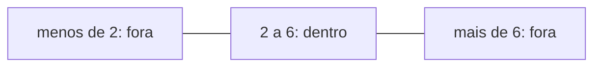
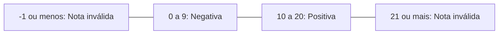

# Seleção

Neste guia, os teus programas passam a decidir: fazem uma coisa num caso e outra coisa noutro, conforme os valores que leem. Traduzes para Python as decisões que já escreves em pseudocódigo e testas cada caminho nas fronteiras. Um valor que não serve faz o programa avisar e acabar.

Usa as decisões da algoritmia. Rever: [Seleção encadeada](../01-algoritmos/03-decisoes-e-validacao.md#seleção-encadeada), [Operadores lógicos](../01-algoritmos/03-decisoes-e-validacao.md#operadores-lógicos-e-ou-e-não), [Intervalos](../01-algoritmos/03-decisoes-e-validacao.md#intervalos) e [Fronteiras e casos de teste](../01-algoritmos/03-decisoes-e-validacao.md#fronteiras-e-casos-de-teste). Para praticar: [laboratório](laboratorios/03-selecao-laboratorio.md) e [ficha de exercícios](exercicios/03-selecao-exercicios.md).

## Neste guia

1. [As comparações dão `True` ou `False`](#as-comparações-dão-true-ou-false)
2. [Decidir com `if`](#decidir-com-if)
3. [Os dois pontos e a indentação marcam o bloco](#os-dois-pontos-e-a-indentação-marcam-o-bloco)
4. [Dois caminhos, com `if` e `else`](#dois-caminhos-com-if-e-else)
5. [Uma conta que só se faz num dos ramos](#uma-conta-que-só-se-faz-num-dos-ramos)
6. [Mais de dois caminhos, com a cadeia `elif`](#mais-de-dois-caminhos-com-a-cadeia-elif)
7. [A ordem das condições conta](#a-ordem-das-condições-conta)
8. [Juntar condições com `and`, `or` e `not`](#juntar-condições-com-and-or-e-not)
9. [Validar os valores antes de os usar](#validar-os-valores-antes-de-os-usar)
10. [Uma decisão dentro de outra](#uma-decisão-dentro-de-outra)
11. [Os casos de fronteira escolhem-se antes de correr](#os-casos-de-fronteira-escolhem-se-antes-de-correr)
12. [Escolher entre valores certos com `match`](#escolher-entre-valores-certos-com-match)
13. [Exemplo guiado: validar e classificar a nota de um teste](#exemplo-guiado-validar-e-classificar-a-nota-de-um-teste)

## As comparações dão `True` ou `False`

Um jogo só te deixa passar ao nível seguinte se tiveres pontos que cheguem. Antes de decidir, o programa faz uma pergunta que só tem duas respostas: é a condição da algoritmia.

Em Python, as duas respostas escrevem-se com maiúscula, `True` e `False`. Uma comparação é uma conta cujo resultado é um destes dois valores: tal como `7 + 3` dá `10`, `7 > 3` dá `True`. Os sinais são os do pseudocódigo das aulas.

| Sinal | A pergunta |
| --- | --- |
| `==` | é igual a? |
| `!=` | é diferente de? |
| `<` | é menor do que? |
| `<=` | é menor ou igual a? |
| `>` | é maior do que? |
| `>=` | é maior ou igual a? |

Antes de leres as respostas, prevê o que dá cada linha, com `pontos` a valer 50.

```text
>>> pontos = 50
>>> pontos > 50
False
>>> pontos >= 50
True
>>> pontos != 50
False
```

Com 50, `pontos > 50` é falso e `pontos >= 50` é verdadeiro. Os dois sinais só dão respostas diferentes num valor, o próprio 50: com 49 dão os dois `False`, e com 51 dão os dois `True`.

Os textos também se comparam. Dois textos são iguais quando têm exatamente as mesmas letras, pela mesma ordem, e uma maiúscula não é igual a uma minúscula.

```text
>>> resposta = "sim"
>>> resposta == "sim"
True
>>> resposta == "Sim"
False
```

<details>
<summary>Para ires mais longe: guardar o resultado de uma comparação</summary>

O resultado de uma comparação pode ficar numa variável, como o de uma conta. Com `idade = 15`, a linha `maior_de_idade = idade >= 18` guarda `False`.

</details>

## Decidir com `if`

Um programa avisa quando a bateria do telemóvel está abaixo dos 20 por cento. Com o que já sabias, um `print` escrevia sempre, fosse qual fosse a bateria. Falta uma forma de dizer "escreve isto só se".

É a seleção simples da algoritmia. Em Python, o `Se` passa a `if`, e a linha acaba em dois pontos.

```python
# bateria.py: avisa quando a bateria do telemóvel está fraca.
LIMITE_BATERIA_FRACA = 20

bateria = int(input("Bateria em percentagem? "))
if bateria < LIMITE_BATERIA_FRACA:
    print("Bateria fraca. Liga o carregador.")
print("Bateria verificada.")
```

| `bateria` | `bateria < LIMITE_BATERIA_FRACA` | O que aparece |
| ---: | --- | --- |
| 15 | `15 < 20` dá `True` | O aviso e `Bateria verificada.` |
| 50 | `50 < 20` dá `False` | Só `Bateria verificada.` |

A linha de baixo do `if` está quatro espaços mais para dentro, e por isso só se executa quando a condição dá `True`. A última linha volta à margem do `if`, e por isso executa-se sempre.

O erro típico é escrever `=` numa condição, em vez de `==`. Com `if bateria = 100:` na linha 5, o Python recusa o programa logo ao início:

```text
  File "C:\Users\aluno\Documents\fp-python\bateria.py", line 5
    if bateria = 100:
       ^^^^^^^^^^^^^
SyntaxError: invalid syntax. Maybe you meant '==' or ':=' instead of '='?
```

Quer dizer "escrita inválida: talvez quisesses `==`". O outro sinal que a mensagem propõe não é para aqui. Numa condição queres sempre perguntar, e por isso o igual é sempre `==`.

<details>
<summary>Para ires mais longe: a bateria exatamente no limite</summary>

Com a bateria a 20, `20 < 20` dá `False`, porque 20 não é menor do que 20, e o aviso não aparece. Para avisar também aos 20, a condição seria `bateria <= LIMITE_BATERIA_FRACA`. Essa decisão tira-se do enunciado, e não do código.

</details>

## Os dois pontos e a indentação marcam o bloco

No pseudocódigo, era a indentação que mostrava o que estava dentro do `Se`. Em Python também é, e há mais um sinal: os dois pontos no fim da linha do `if`. Dizem que a seguir vem um bloco, e sem eles o programa é recusado.

A indentação escreve-se com quatro espaços por nível. No VS Code, quando carregas em Enter depois dos dois pontos, a linha seguinte já começa com os quatro espaços. O bloco acaba na primeira linha que volta à margem do `if`, e nenhuma palavra marca esse fim.

Por isso, mudar uma linha de margem pode mudar o que o programa faz. Estas duas versões do `bateria.py` só diferem na margem da última linha.

```python
# Primeira versão: a última linha está fora do bloco.
if bateria < LIMITE_BATERIA_FRACA:
    print("Bateria fraca. Liga o carregador.")
print("Bateria verificada.")
```

```python
# Segunda versão: a última linha está dentro do bloco.
if bateria < LIMITE_BATERIA_FRACA:
    print("Bateria fraca. Liga o carregador.")
    print("Bateria verificada.")
```

| `bateria` | Primeira versão | Segunda versão |
| ---: | --- | --- |
| 15 | Aviso e `Bateria verificada.` | Aviso e `Bateria verificada.` |
| 50 | `Bateria verificada.` | nada |

Com 15, as duas mostram o mesmo, e só o 50 revela a diferença. Se querias a primeira e escreveste a segunda, tens um erro de lógica: o programa corre até ao fim, sem mensagem. É por isso que se testa cada ramo, e não só o caso em que o aviso aparece.

## Dois caminhos, com `if` e `else`

Um jogo PEGI 12 é para quem tem 12 anos ou mais. Um programa que verifique a idade tem duas mensagens, e escreve sempre uma delas.

O `Senão` passa a `else`, que não tem condição e apanha todos os casos em que a do `if` é falsa. Escreve-se na mesma margem do `if`, e tem dois pontos, porque também abre um bloco.

```python
# pegi.py: diz se a idade chega para um jogo com a classificação PEGI 12.
IDADE_MINIMA = 12

idade = int(input("Que idade tens? "))
if idade >= IDADE_MINIMA:
    print("Podes jogar este jogo.")
else:
    print("Este jogo é para quem tem", IDADE_MINIMA, "anos ou mais.")
```

| `idade` | `idade >= IDADE_MINIMA` | Bloco executado |
| ---: | --- | --- |
| 11 | `11 >= 12` dá `False` | o do `else` |
| 12 | `12 >= 12` dá `True` | o do `if` |
| 13 | `13 >= 12` dá `True` | o do `if` |

Executa-se sempre um dos dois blocos, e só um. Não há nenhuma idade para a qual apareçam as duas mensagens, nem nenhuma para a qual não apareça nenhuma.

## Uma conta que só se faz num dos ramos

No guia 02, o `cartas.py` parava com `ZeroDivisionError` quando havia 0 jogadores. Agora já podes evitá-lo: as contas vão para dentro do bloco de um `if`, e só se fazem quando há jogadores.

```python
# cartas.py: reparte as cartas de um baralho pelos jogadores, sem partir nenhuma.
CARTAS_DO_BARALHO = 52

jogadores = int(input("Quantos jogadores? "))
# Sem este if, com 0 jogadores, o // dividia por zero e o programa parava.
if jogadores > 0:
    cartas_por_jogador = CARTAS_DO_BARALHO // jogadores
    cartas_que_sobram = CARTAS_DO_BARALHO % jogadores
    print("Cada jogador recebe", cartas_por_jogador, "cartas")
    print("Sobram", cartas_que_sobram, "cartas")
else:
    print("Sem jogadores, não há cartas para repartir.")
```

Com 5 jogadores, aparecem as duas linhas das cartas. Com 0, `0 > 0` dá `False`, o bloco é saltado inteiro, e a divisão nunca se faz. Sempre que uma conta divide por um valor lido, pergunta-te: e se esse valor for zero?

## Mais de dois caminhos, com a cadeia `elif`

O ecrã de um jogo muda conforme as vidas. Com 0 vidas, o jogo acabou. Com 1 ou 2, estás quase a perder. Com 3 ou mais, o jogo continua.

O `Senão se` passa a `elif`, o `else` encurtado e colado ao `if`.

```python
# vidas.py: a mensagem do ecrã de um jogo, conforme as vidas que restam.
vidas = int(input("Quantas vidas tens? "))
if vidas == 0:
    print("Fim do jogo")
elif vidas < 3:
    print("Cuidado, estás quase a perder")
else:
    print("O jogo continua")
```

| `vidas` | `vidas == 0` | `vidas < 3` | Bloco executado |
| ---: | --- | --- | --- |
| 5 | `False` | `False` | o do `else` |
| 2 | `False` | `True` | o do `elif` |
| 0 | `True` | não é avaliada | o do `if` |

As condições avaliam-se de cima para baixo, e a primeira verdadeira ganha. Executa-se o seu bloco, e o programa continua na primeira linha depois da cadeia. Se nenhuma for verdadeira, executa-se o bloco do `else`, se houver. Pode haver tantos `elif` quantos forem precisos, todos na mesma margem.

Por isso, quando o Python chega ao `elif vidas < 3`, já sabe que as vidas não são 0, e a condição não precisa de o perguntar.

## A ordem das condições conta

Alguém escreveu a mesma cadeia com o aviso primeiro. Antes de leres a resposta, prevê o que esta versão escreve com 0 vidas.

```python
if vidas < 3:
    print("Cuidado, estás quase a perder")
elif vidas == 0:
    print("Fim do jogo")
else:
    print("O jogo continua")
```

Escreve "Cuidado, estás quase a perder", porque 0 é menor do que 3 e a primeira condição verdadeira ganha. A mensagem "Fim do jogo" nunca aparece, e o programa corre sem nenhuma mensagem de erro. Só o caso 0 revela este erro de lógica.

Quando uma condição está contida noutra, como "ter 0 vidas" está contida em "ter menos de 3", a que apanha menos valores vem primeiro.

## Juntar condições com `and`, `or` e `not`

O torneio de jogos da escola é para alunos dos 12 aos 17 anos, incluindo os 12 e os 17. A idade tem de cumprir duas comparações ao mesmo tempo. Na algoritmia, juntavas condições com `e`, `ou` e `não`, e em Python as três passam para inglês, em minúsculas.

| Pseudocódigo | Python | Quando dá `True` |
| --- | --- | --- |
| `e` | `and` | só quando as duas condições são verdadeiras |
| `ou` | `or` | quando pelo menos uma das duas é verdadeira |
| `não` | `not` | quando a condição é falsa: troca o valor |

```text
>>> idade = 19
>>> idade >= 12 and idade <= 17
False
>>> idade < 12 or idade > 17
True
>>> not (idade >= 12)
False
```

Na primeira condição, o Python calcula cada comparação e só depois junta os resultados: `19 >= 12` dá `True`, `19 <= 17` dá `False`, e `True and False` dá `False`. Na segunda, basta uma ser verdadeira, e a idade fica fora do torneio. Na terceira, o `not` troca o `True` de `19 >= 12`.

O contrário de "a idade é 12 ou mais" não é "a idade é 12 ou menos". É "a idade é menos de 12", e o limite muda de lado. Nas aulas, escreve-se `idade < 12`, mais fácil de ler do que `not (idade >= 12)`.

<details>
<summary>Para ires mais longe: misturar `and` e `or`</summary>

Quando se misturam os dois, os parênteses mostram o que se avalia primeiro, como na algoritmia. Na piscina, entra quem paga e traz touca, ou quem tem menos de 6 anos. A condição certa é `(paga and touca) or idade < 6`. Com `paga and (touca or idade < 6)`, uma criança de 4 anos que não paga já não entra.

</details>

## Validar os valores antes de os usar

Quem quer escrever 4 pode escrever 44, ou -4. Um programa que aceita esses valores dá respostas erradas com ar de certas. Validar é confirmar que um valor serve antes de o usar, como na algoritmia.

Um jogo de tabuleiro joga-se com 2 a 6 jogadores, incluindo os extremos. Os valores aceites formam um intervalo.



Para estar dentro, um valor tem de cumprir as duas comparações: `jogadores >= 2 and jogadores <= 6`. Para estar fora, basta falhar uma: `jogadores < 2 or jogadores > 6`. O `and` passou a `or`, e cada comparação passou ao seu contrário.

```python
# jogadores.py: confirma o número de jogadores de um jogo de tabuleiro, de 2 a 6.
MINIMO_JOGADORES = 2
MAXIMO_JOGADORES = 6

jogadores = int(input("Quantos jogadores (2 a 6)? "))
if jogadores < MINIMO_JOGADORES or jogadores > MAXIMO_JOGADORES:
    print("Esse número não dá. O jogo é para 2 a 6 jogadores.")
else:
    print("Jogo para", jogadores, "jogadores. Boa sorte!")
```

| `jogadores` | `jogadores < 2` | `jogadores > 6` | Com `or` | O que aparece |
| ---: | --- | --- | --- | --- |
| 1 | `True` | `False` | `True` | o aviso |
| 2 | `False` | `False` | `False` | `Jogo para 2 jogadores. Boa sorte!` |
| 6 | `False` | `False` | `False` | `Jogo para 6 jogadores. Boa sorte!` |
| 7 | `False` | `True` | `True` | o aviso |

O erro típico é ligar com `and` as duas comparações que dizem "fora". Nenhum número é ao mesmo tempo menor do que 2 e maior do que 6, e a condição dá sempre `False`. Com 7, o programa diz `Jogo para 7 jogadores. Boa sorte!`. Quem só testa valores do meio, como o 4, não dá por isso.

A validação só funciona depois de o `int` ter convertido o texto. Se a pessoa escrever `dois`, o programa para antes de chegar ao `if`, com o `ValueError` do guia 02. Por agora, quem usa o programa tem de escrever um número inteiro.

<details>
<summary>Para ires mais longe: a forma curta de um intervalo</summary>

O Python aceita também `2 <= jogadores <= 6`, que se lê como na matemática. Nas aulas, escrevem-se as duas comparações ligadas por `and`. No C, a linguagem que vem depois do Python, a forma curta não dá o mesmo.

</details>

## Uma decisão dentro de outra

Com 6 jogadores, o jogo quer dizer que a mesa ficou cheia. Essa mensagem só faz sentido para um número válido, e por isso a decisão nova vai para dentro do bloco do `else`.

```python
# jogadores.py: confirma o número de jogadores de um jogo de tabuleiro, de 2 a 6.
MINIMO_JOGADORES = 2
MAXIMO_JOGADORES = 6

jogadores = int(input("Quantos jogadores (2 a 6)? "))
if jogadores < MINIMO_JOGADORES or jogadores > MAXIMO_JOGADORES:
    print("Esse número não dá. O jogo é para 2 a 6 jogadores.")
else:
    print("Jogo para", jogadores, "jogadores. Boa sorte!")
    # Este if está dentro do else: só se avalia com um número válido.
    if jogadores == MAXIMO_JOGADORES:
        print("Mesa cheia: já não entra mais ninguém.")
```

Com 6, aparecem as duas mensagens. Com 4, só a primeira. Com 7, só o aviso, porque o programa salta o `else` inteiro, com o `if` que está lá dentro. O `print` da mesa cheia tem oito espaços, porque está dentro de dois blocos.

## Os casos de fronteira escolhem-se antes de correr

Um programa testado só com 5 e com 50 pode ter o sinal errado sem tu dares por isso. A resposta do `bateria.py` muda entre 19 e 20, numa fronteira, e é aí que os erros se escondem.

A regra é a da algoritmia. Para cada fronteira, testas o valor imediatamente abaixo, o próprio valor e o imediatamente acima. O resultado esperado sai do enunciado e calcula-se antes de correr. Se o copiasses do ecrã, o teste concordava sempre com o programa.

| Caso | Resultado esperado | O ramo |
| ---: | --- | --- |
| 19 | O aviso e `Bateria verificada.` | Entra no bloco do `if` |
| 20 | Só `Bateria verificada.` | Salta o bloco |
| 21 | Só `Bateria verificada.` | Salta o bloco |

## Escolher entre valores certos com `match`

O menu de um jogo oferece 1 para jogar, 2 para ver as instruções e 3 para sair. Com uma cadeia de `if`, cada condição repete `opcao ==`. Para comparar um só valor com vários valores fixos, o Python tem uma forma que não repete o nome, o **`match`**.

```python
# menu.py: o menu de um jogo, com uma mensagem para cada opção.
opcao = int(input("1 Jogar, 2 Instruções, 3 Sair. Escolhe: "))
match opcao:
    case 1:
        print("A começar o jogo.")
    case 2:
        print("Adivinha o número secreto em 10 tentativas ou menos.")
    case 3:
        print("Até à próxima!")
    case _:
        print("Essa opção não existe.")
```

O Python compara a `opcao` com cada `case`, de cima para baixo, e executa o bloco do primeiro que for igual. O `case _`, com o traço baixo, apanha qualquer outro valor, como o `else` de uma cadeia, e fica sempre no fim.

| `opcao` | `case` que a apanha | O que aparece |
| ---: | --- | --- |
| 1 | `case 1` | `A começar o jogo.` |
| 2 | `case 2` | as instruções |
| 7 | `case _` | `Essa opção não existe.` |

Os valores de um `case` também podem ser textos, entre aspas. Sem as aspas, `s` seria o nome de uma variável, e o Python recusa o programa.

```python
# outra_vez.py: no fim de um jogo, pergunta se a pessoa quer jogar outra vez.
resposta = input("Queres jogar outra vez (s/n)? ")
match resposta:
    case "s":
        print("Nova partida a começar.")
    case "n":
        print("Obrigado por jogares.")
    case _:
        print("Responde só s ou n.")
```

O `input` não tem `int` à volta, porque a resposta é um texto. Com `sim`, ou com `S` maiúsculo, o programa cai no `case _`, porque o texto não é igual a nenhum dos dois.

Nas aulas, o `match` usa-se só para comparar um valor com valores fixos. Para uma condição como `nota >= 10`, ou para juntar condições, usa-se o `if`. Quando não tens a certeza, a cadeia de `if` serve sempre.

O `match` precisa do Python 3.10 ou mais recente. Confirma a tua versão no terminal, com `python --version` (no macOS, `python3 --version`).

## Exemplo guiado: validar e classificar a nota de um teste

### O enunciado

Um professor quer um programa que o ajude a classificar os testes. O programa lê a nota de um teste, um número inteiro na escala de 0 a 20. Se a nota for igual ou superior a 10, escreve "Positiva". Se for inferior a 10, escreve "Negativa". Se a nota escrita não pertencer à escala, escreve "Nota inválida" e não a classifica.

Este problema está resolvido em pseudocódigo no [guia 03 da algoritmia](../01-algoritmos/03-decisoes-e-validacao.md#exemplo-guiado-validar-e-classificar-uma-nota). Agora o computador corre os casos.

### Os casos de teste, antes do programa

A resposta muda em três sítios:



As fronteiras são o 0, o 10 e o 20, os números que o enunciado escreve. Para cada uma, escolhem-se o valor de baixo, ela própria e o de cima.

| Nota | Esperado | Nota | Esperado | Nota | Esperado |
| ---: | --- | ---: | --- | ---: | --- |
| -1 | Nota inválida | 9 | Negativa | 19 | Positiva |
| 0 | Negativa | 10 | Positiva | 20 | Positiva |
| 1 | Negativa | 11 | Positiva | 21 | Nota inválida |

### Do pseudocódigo ao Python

```text
const NOTA_MINIMA = 0
const NOTA_MAXIMA = 20
const LIMIAR_POSITIVA = 10
Escreve: "Nota do teste (inteiro de 0 a 20)?"
int nota = ler valor
Se nota < NOTA_MINIMA ou nota > NOTA_MAXIMA
    Escreve: "Nota inválida"
Senão se nota >= LIMIAR_POSITIVA
    Escreve: "Positiva"
Senão
    Escreve: "Negativa"
```

A validação é a primeira condição da cadeia, com `ou`. A condição de positiva não precisa de dizer que a nota é menor ou igual a 20. Quando o programa lá chega, já sabe que a nota é válida.

### O programa, parte a parte

Começa-se pela validação, que é o que vem primeiro:

```python
# classificar_nota.py: valida a nota de um teste e classifica-a como positiva ou negativa.
NOTA_MINIMA = 0
NOTA_MAXIMA = 20

nota = int(input("Nota do teste (inteiro de 0 a 20)? "))
# A validação vem primeiro: uma nota fora da escala não se classifica.
if nota < NOTA_MINIMA or nota > NOTA_MAXIMA:
    print("Nota inválida")
```

Com 21, escreve `Nota inválida`, e com 15 não escreve nada. Acrescenta-se depois a classificação, com a constante do limiar. O programa completo fica assim:

```python
# classificar_nota.py: valida a nota de um teste e classifica-a como positiva ou negativa.
NOTA_MINIMA = 0
NOTA_MAXIMA = 20
LIMIAR_POSITIVA = 10

nota = int(input("Nota do teste (inteiro de 0 a 20)? "))
# A validação vem primeiro: uma nota fora da escala não se classifica.
if nota < NOTA_MINIMA or nota > NOTA_MAXIMA:
    print("Nota inválida")
elif nota >= LIMIAR_POSITIVA:
    print("Positiva")
else:
    print("Negativa")
```

### Correr os casos

Corre-se o programa nove vezes, uma por caso. Os resultados coincidem com a tabela em todos. O 0 é negativa, e não inválida, porque `0 < 0` dá `False`. O 10 é positiva porque `10 >= 10` dá `True`. O 20 é positiva porque `20 > 20` dá `False`. Em cada fronteira, quem decide é um só sinal.

### A fronteira trocada

Se tivesses escrito `elif nota > LIMIAR_POSITIVA:`, sem o igual, todos os casos batiam certo até ao 9, e o 10 mostrava `Negativa`. Seguias a rotina de cinco passos do tema 01:

1. Observar e reproduzir. Com 10, esperava-se "Positiva", apareceu "Negativa", e o programa acabou sem mensagem: é um erro de lógica.
2. Formular uma hipótese. "A condição de positiva deixa o 10 de fora."
3. Verificar a hipótese. Na consola, `10 > 10` dá `False`, e `10 >= 10` dá `True`.
4. Corrigir a causa. Muda-se o `>` para `>=`, porque o enunciado diz "igual ou superior a 10".
5. Voltar a testar tudo. Correm-se outra vez os nove casos.

Com o `>`, o 9 e o 11 davam o resultado certo. Só o próprio 10 mostrava o erro, e é por isso que o valor da fronteira está sempre nos casos.

## Erros frequentes

### A indentação em falta

Com a linha do aviso do `bateria.py` encostada à margem, aparece:

```text
  File "C:\Users\aluno\Documents\fp-python\bateria.py", line 6
    print("Bateria fraca. Liga o carregador.")
    ^^^^^
IndentationError: expected an indented block after 'if' statement on line 5
```

Quer dizer "erro de indentação: esperava-se um bloco indentado depois do `if` da linha 5". Depois de uma linha que acaba em dois pontos, o Python exige pelo menos uma linha indentada. O programa nem arranca. Corrige-se com quatro espaços antes da linha, com a tecla Tab.

### Os dois pontos esquecidos

Com `if nota >= 10`, sem os dois pontos, aparece `SyntaxError: expected ':'`, e o `^` aponta para o fim da linha. Acontece a quem traduz o pseudocódigo à letra. Corrige-se acrescentando os dois pontos: todas as linhas que abrem um bloco acabam neles.

### Palavras do pseudocódigo no meio do Python

Com `if idade >= 12 e idade <= 17:`, aparece `SyntaxError: invalid syntax`, e o `^` aponta para o `e`. O Python não conhece o `e`, o `ou`, o `não`, o `Se` nem o `Senão`. Corrige-se com a palavra do Python: aqui, `and`.

### Dois `if` separados em vez de uma cadeia

Com a validação num `if` e a classificação noutro `if` a seguir, na mesma margem, uma nota de 21 mostra duas mensagens:

```text
Nota do teste (inteiro de 0 a 20)? 21
Nota inválida
Positiva
```

Um `if` encostado à margem começa uma decisão nova, e o segundo avalia-se sempre. Quando só um dos casos deve acontecer, escrevem-se numa só cadeia, com `elif`.

## Palavras novas deste guia

- `match`, `case` e `case _`: a forma de comparar um valor com vários valores fixos, com um `case _` no fim para os outros.
- `IndentationError`: o erro de um bloco sem linhas indentadas.

## O que vem a seguir

No tema seguinte, [Ciclos while e for](04-ciclos-while-e-for.md), o programa passa a repetir instruções, e já pode voltar a pedir um valor até ele ser válido.


